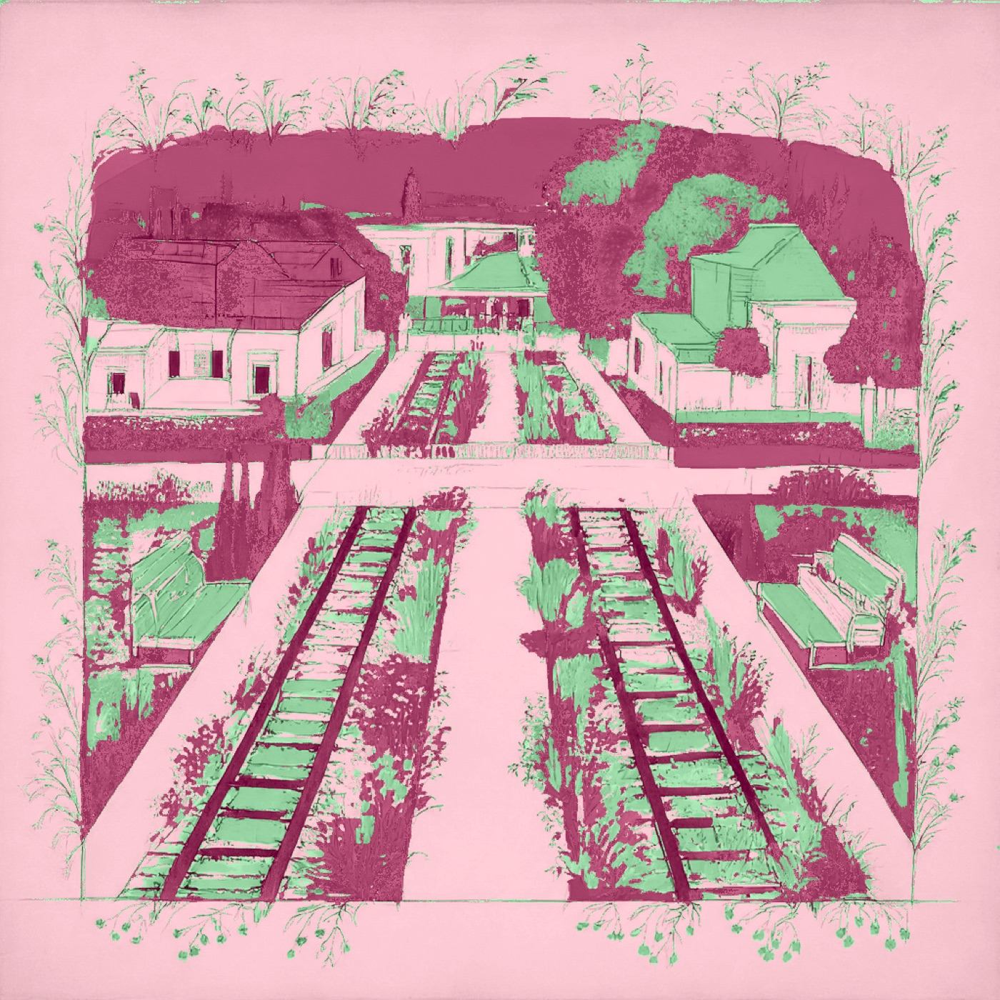
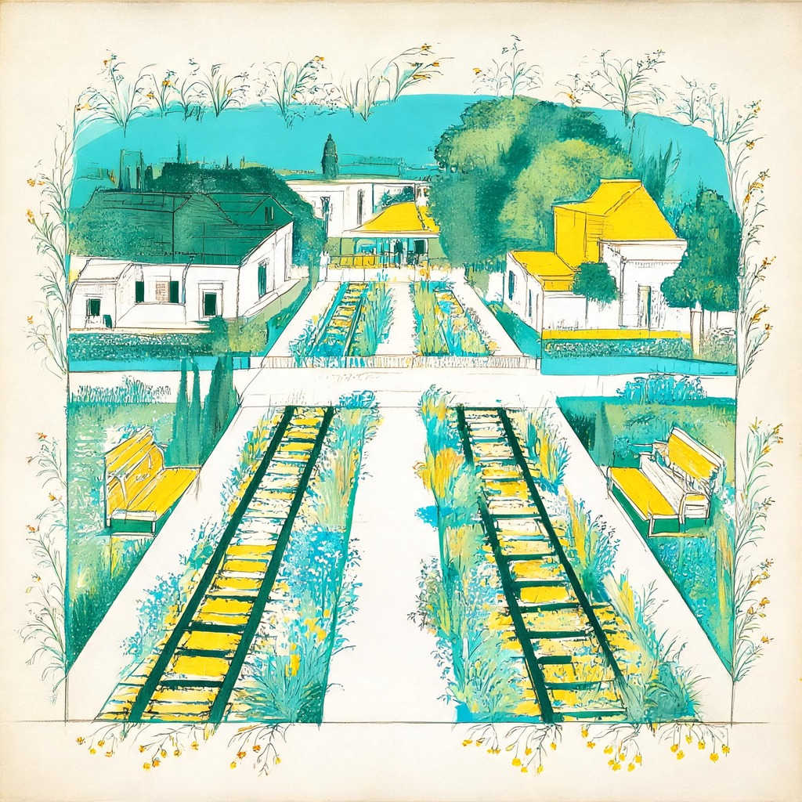
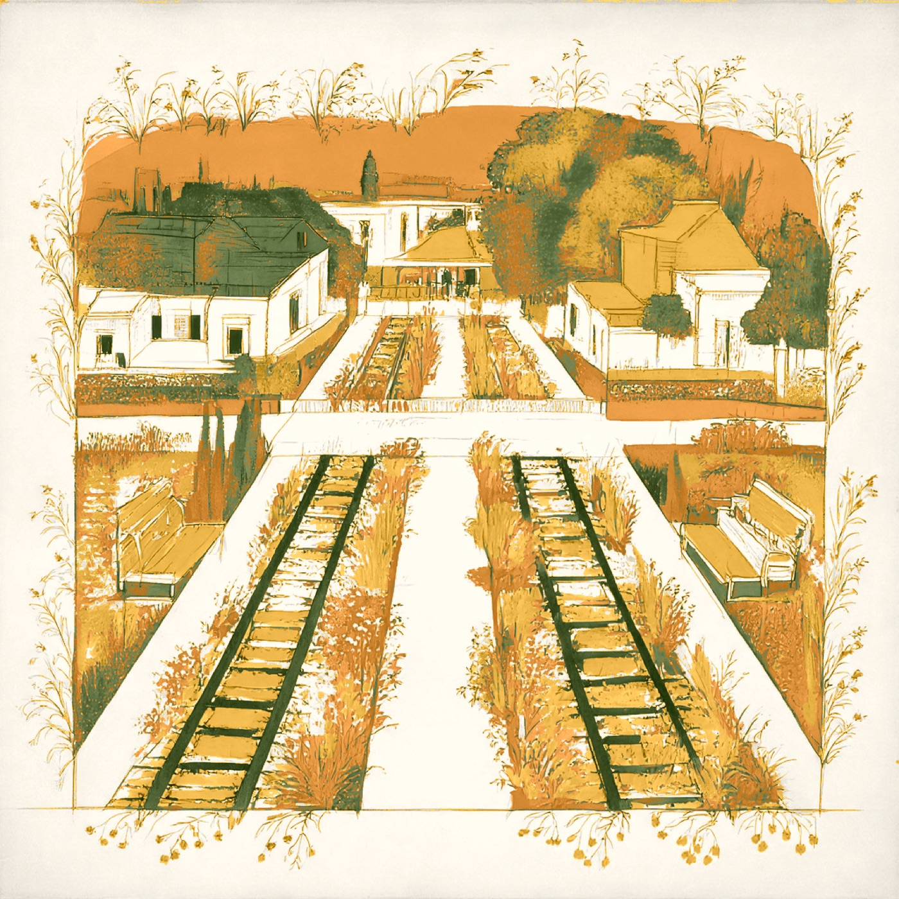
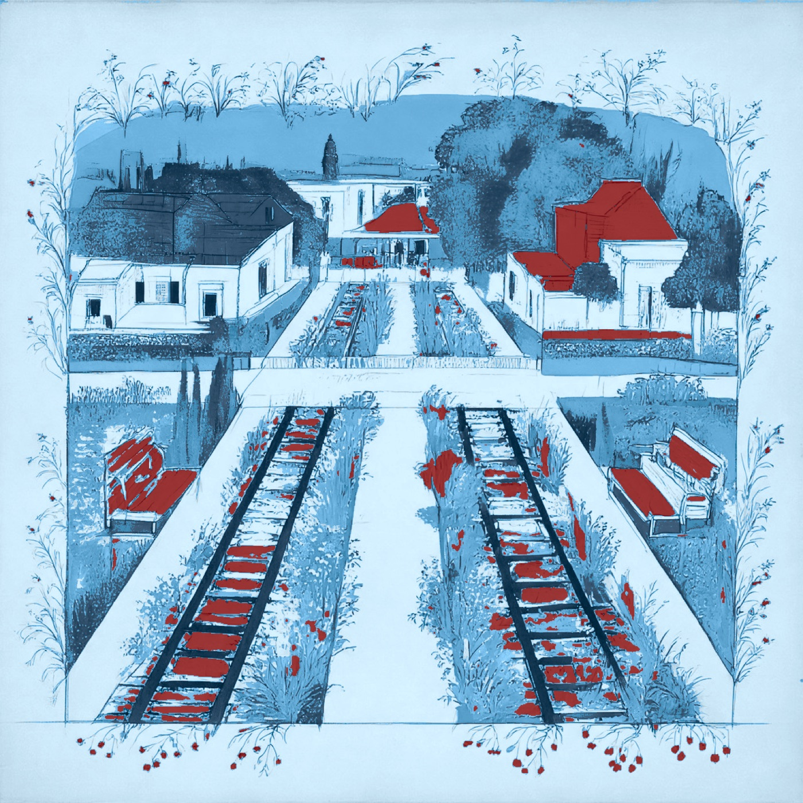

# Storybound

**Your trip, one chapter a day.**

Storybound turns a travel itinerary into a story told in chapters. Each day of the trip gets one small piece designed for that place, season and mood, ordered before you go, plus a note on when to be there and where to stand for the photo. After the trip, the story closes with an Epilogue: a lampshade printed with the whole journey.

Built in one afternoon at the Shopping 3.0 hackathon (October 11, 2026) on the [Arcade](https://docs.arcade.ai) API.

**Live:** https://storybound-rho.vercel.app

<p>
  
  
  
  
</p>

*One scarf design, recolored by Arcade for each season.*

## What it does

1. **Your trip.** Paste an itinerary in any form, or add a screenshot. The days are read out and stay editable: place, city, date.
2. **About you.** Pick a season, a mood, a style and a metal. Metal and fabric choices come from Arcade's live category options.
3. **Your story.** Every day becomes a chapter with a title, a piece and a live price. Pieces are made by Arcade while you watch, up to five at a time.
4. **The day card.** Each chapter shows the best light window for that place and date, where to stand, the angle and how to wear the piece.
5. **Checkout.** Arcade's hosted checkout, for the pieces Arcade makes.
6. **The Epilogue.** After the trip: a drum lampshade of the whole journey, and a charm for each thing you did.

Two ways in from the Welcome screen:

- **Start my story** runs everything live for any destination.
- **Try it with a New York trip** loads a five-chapter example that was made ahead of time, in all four seasons, so it appears at once.

## What is real and what is a preview

| Piece | Status |
| --- | --- |
| Scarf, pendant, hair ribbon | Real Arcade products with live prices and checkout |
| Drum lampshade (Epilogue) | Real Arcade product |
| Pocket square | Offered for your own trips through Arcade's Pocket Squares category; not yet made in testing |
| Brooch, stick-on nails, charm bracelet | Design previews: the art is generated with Arcade, but no product exists |
| Sun-Reveal scarf | A preview animation in the app. The scarf you can order is a standard print |

Prices are never stored as truth. The app asks Arcade for the price every time a page loads.

## How it uses Arcade

Every call is a server-side `POST` to `https://platform.arcade.ai/v1`. The client lives in [`lib/arcade.ts`](lib/arcade.ts).

| Step | Endpoint |
| --- | --- |
| Find categories by name, read their options | `categories/list`, `categories/get` |
| Generate a design (print or jewelry) | `patterns/create` |
| Poll long-running work | `jobs/get` |
| Recolor a design for another season | `patterns/refine/recolorClusters`, `patterns/refine/recolor` |
| Make a ribbon repeat, widen a lampshade scene | `patterns/refine/makeSeamless`, `patterns/refine/extendScene` |
| Use trip photos as references | `references/createUpload`, `references/create` |
| Build a product and read its live price | `products/create`, `products/get` |
| Hand off to payment | `checkouts/create` |

Rules the code follows:

- Category IDs are never hardcoded. They are looked up by name.
- Jobs start on the server and return a `jobId`. The browser polls; no request waits for a job.
- `requestId`s are stable, so a refresh or a retry never starts duplicate work.
- Prompts describe places generically, with no names, brands or lettering.
- Jewelry is text only: no colors, references or refines.

## The writing layer

Server routes call Claude (`claude-opus-5-5`) through the Anthropic SDK and ask for JSON. Each one has a fallback, so the app still works without the key.

| Route | Job | Fallback |
| --- | --- | --- |
| `/api/ai/itinerary` | Read days, dates and places from text or a screenshot | Line-by-line parser |
| `/api/plan` | For any trip: locate each place, choose a piece per day, write the chapter and the Arcade prompt | Templates built from the traveler's own words |
| `/api/ai/story` | Chapter titles for the New York example | Hand-written titles |
| `/api/ai/coach` | Rewrite photo tips from supplied facts only | Tips assembled from calculated sun times |
| `/api/ai/outfit` | Pull three colors from an outfit photo | Season palette only |
| `/api/ai/epilogue` | Choose charms and the best three photos | The traveler's own list |

Sun times and direction are calculated with `suncalc` for the place and date. Coordinates and time zones come from Open-Meteo's free geocoding API. The photo coach is only allowed to use those facts and never invents opening hours or crowd levels.

## Run it locally

Requires Node 20 or newer.

```bash
npm install
```

Create `.env.local` in the project root:

```bash
ARCADE_API_KEY=
ANTHROPIC_API_KEY=
# optional: contact shown in the Arcade User-Agent header
ARCADE_CONTACT_EMAIL=
```

Then:

```bash
npm run dev
```

Open http://localhost:3000.

Keys are read only by server code. `.env*` is gitignored. Without `ANTHROPIC_API_KEY` the fallbacks above are used; without `ARCADE_API_KEY` no pieces can be made.

## Scripts

| Command | What it does |
| --- | --- |
| `npm run categories` | Prints the categories the app uses and their live options |
| `npm run scarf` | Makes one scarf end to end: pattern, product, price |
| `npm run pregen` | Makes the New York example and saves IDs to `data/demo-pack.json` |
| `npm run pregen -- --only ribbon,seasons` | Runs named tasks or groups only |

`pregen` starts real Arcade jobs, five at a time, and skips anything already in the pack.

## Project layout

```
app/
  page.tsx              Welcome
  trip/                 Paste or enter an itinerary
  you/                  Season, mood, style, metal
  story/                Chapter doors, live prices, checkout
  chapter/[n]/          Day card: light, where to stand, the piece
  epilogue/             Lampshade and charm bracelet
  api/
    arcade/             generate, job, pattern, product, upload, checkout
    ai/                 itinerary, story, coach, outfit, epilogue
    plan/               Any itinerary to chapters
    pack/               New York example with live prices
    categories/         Live category options
components/             Ink icons, season theme, piece art, hooks
lib/
  arcade.ts             Arcade client
  ai.ts                 Anthropic client
  sun.ts                Sun times and direction
  prompts.ts            Arcade prompts and system prompts
  places.ts             New York place library and copy
  palettes.ts           Season palettes and recolor mapping
scripts/pregen.ts       Pre-generation pipeline
data/demo-pack.json     Arcade IDs for the New York example
public/demo/            Local copies of the generated art
```

## Tech

Next.js 16 (App Router), React 19, TypeScript, plain CSS, `suncalc`, `@anthropic-ai/sdk`. Deployed on Vercel. No database: trip state lives in the browser's `localStorage`.

## Known limits

- A piece takes about 100 seconds to make, so a new trip fills in over a couple of minutes.
- Delivery lead times are not known, so the app shows no order-by date.
- The lampshade-from-your-photos flow, outfit color match and the Epilogue curator are built but were not tested end to end.
- The weather swap is a static card, not a live forecast.
- There is no rate limiting. A public deployment lets anyone start jobs on the configured keys.

## Credits

Team Storybound, Shopping 3.0 hackathon. Art from the places you go, designed with AI, made by Arcade.
